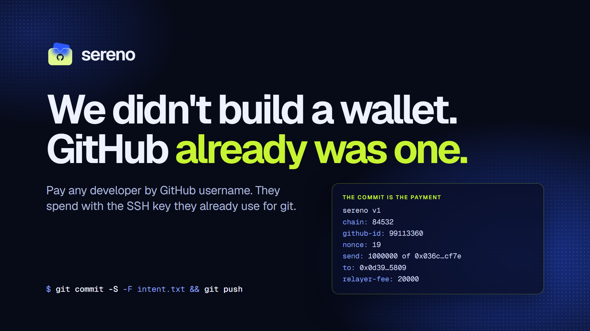
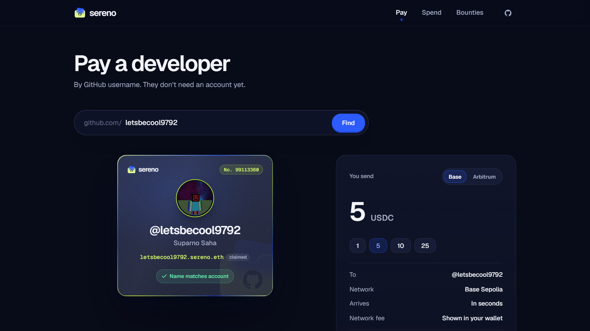
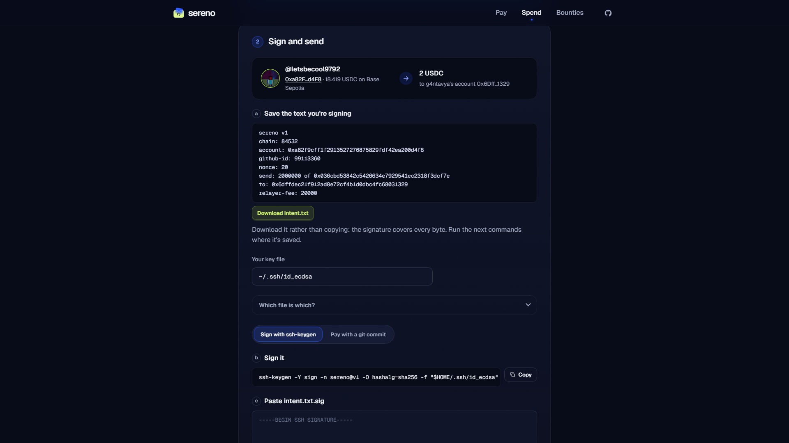
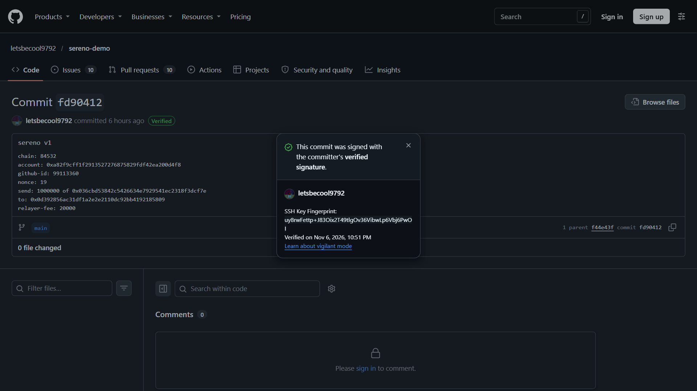
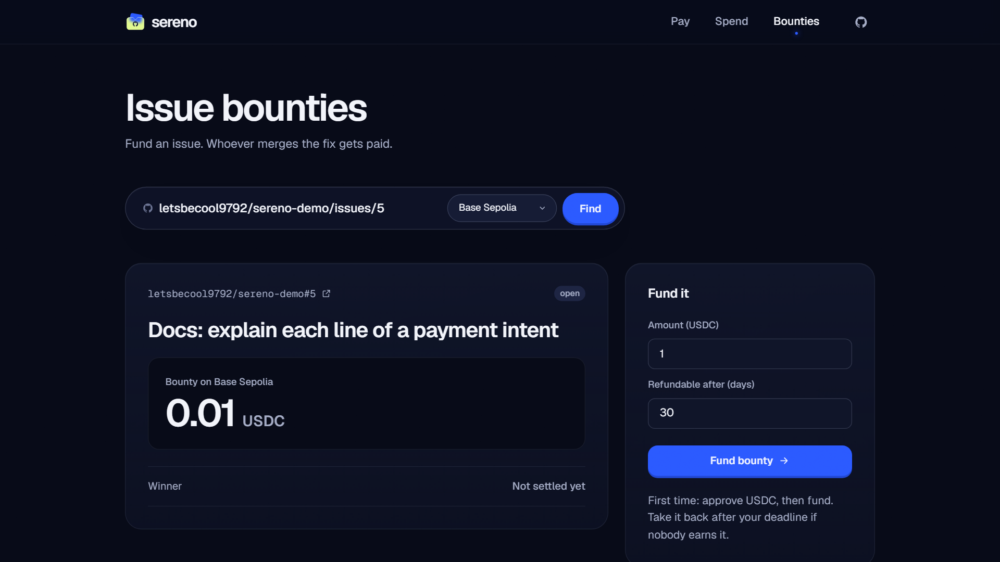

<p align="center"></p>

# Sereno

**Pay any developer by GitHub username. They spend with the SSH key they already use for git.**

[Live app](https://sereno-eth.vercel.app) · [Demo video](https://youtu.be/lGAjhjdORrc) · [ETHGlobal showcase](https://ethglobal.com/showcase/sereno-ypni6) · [CLI on npm](https://www.npmjs.com/package/sereno-ak) · [Walkthrough](docs/WALKTHROUGH.md)

Every GitHub user already has an account anyone can pay by username, even before they've heard of Sereno. The SSH keys on their GitHub profile are what spend from it. They sign a readable payment with the `ssh-keygen` and `git commit -S` they already use, and our contract verifies the SSH signature on-chain. A signed git commit can itself be the payment: push it, and GitHub shows it as Verified while our relayer pays it. No app, no seed phrase, no signup.

Built at ETHGlobal Mumbai 2026. Runs on testnets: Base Sepolia, Arbitrum Sepolia and Ethereum Sepolia (for ENS).

*A sereno was the night watchman of old Spanish towns: he kept the keys and called out that all was calm.*

## How it works

Ethereum transactions are signed with secp256k1 keys. SSH keys use other algorithms: ed25519, P-256 (on disk, or on a phone or security key) and RSA. So each user's money sits in a smart contract that checks SSH signatures itself.

1. **The account.** Each user's account is a contract at a CREATE2 address computed from their numeric GitHub ID: `keccak256(0xff ‖ factory ‖ githubId ‖ keccak256(code))`. Anyone can compute it today, it's the same on every chain, and money can arrive before it's deployed. We use the ID because it never changes, while GitHub gives a renamed username to whoever asks for it next.
2. **The signature.** `ssh-keygen -Y sign` signs an envelope: `SSHSIG`, a namespace, the hash algorithm and the SHA-256 of the message. The account rebuilds the payment text from the call's arguments, rebuilds the envelope and verifies the signature:
   - P-256 through the precompile at `0x100`;
   - phone and security keys the same way, over their authenticator data, with the user-present flag required;
   - RSA through the modexp precompile;
   - ed25519 in Solidity.
3. **The keys.** A contract can't call GitHub, so a [Chainlink CRE](https://docs.chain.link/cre) workflow does. Each node fetches the user's keys, the nodes agree on the sorted list of key hashes, and the result is written to the `KeyOracle`. A key deleted on GitHub disappears at the next run. A spend passes only if the hash of the signature's public key is listed for that GitHub ID.
4. **The commit.** Git's SSH commit signature is the same envelope, with the namespace `git`, over the raw commit object. When the commit message is exactly the payment text, the signed commit is the payment. GitHub verifies the same signature and shows Verified, and the relayer reads the commit and submits it.
5. **The name.** `<user>.sereno.eth` resolves through an ENSv2 wildcard resolver and a CCIP-read gateway: username → GitHub ID → address, signed by the gateway. Claiming the name makes it a real ENSv2 subname owned by the account.

The payment text fixes the chain, account, GitHub ID, nonce, amount, token, recipient and relayer fee. A signature can't be replayed or redirected, and the relayer can't take a bigger fee. A key first seen less than 72 hours ago can't move more than 50 USDC.

| Key type | Verified with | Gas per payment (Base Sepolia) |
|---|---|---|
| P-256 (`ecdsa`), phone or security key (`ecdsa-sk`) | P-256 precompile `0x100` | ~189k |
| RSA | modexp precompile `0x05` | ~287k |
| ed25519 | Solidity (vendored library) | ~1.05M |

On Base mainnet, that would be roughly $0.002, $0.004 and $0.015 per payment.

## Screenshots

| Pay anyone by GitHub username | Spend with stock `ssh-keygen` |
|---|---|
|  |  |
| **The commit is the payment (Verified on GitHub)** | **Issue bounties settled by Chainlink CRE** |
|  |  |

## Try it

**Live (testnet): [sereno-eth.vercel.app](https://sereno-eth.vercel.app)**. Payments are Circle USDC on Base Sepolia or Arbitrum Sepolia ([faucet](https://faucet.circle.com)).

- **Pay someone:** type any GitHub username, then pay from any wallet. It works even if they've never heard of Sereno; the money waits in their account.
- **Spend your balance** (the *Spend* tab): it builds the payment text and gives you the stock command to sign it, `ssh-keygen -Y sign …` or `git commit -S`. Paste the signature, or the link of the pushed commit, and the relayer pays. Your key never touches the page.
  - First time? Press **Sync my keys from GitHub**, so the Chainlink key oracle copies your SSH keys on-chain.
  - Any SSH key on your GitHub profile works, authentication or signing.
- **Issue bounties** (the *Issue bounties* tab): put USDC on any GitHub issue from your wallet. When a merged PR closes the issue, a Chainlink CRE workflow confirms it with GitHub, and the PR author is paid into their Sereno account by GitHub ID. Funders can take their money back after their deadline if nobody earns it.
- **Browser extension** ([`extension/`](extension/README.md)): Pay, bounty and tip buttons on github.com profiles, issues, PRs and commits.
- **CLI** (Node 20+): [`sereno-ak`](https://www.npmjs.com/package/sereno-ak)

```sh
npx sereno-ak account <github-user>                                         # address, balance, which keys are on-chain
npx sereno-ak sync <you>                                                    # copy your GitHub keys on-chain
npx sereno-ak send 1 <friend> --as <you>                                    # finds your key in ~/.ssh, signs with ssh-keygen, relayer submits
npx sereno-ak commit-pay 1 <friend> --as <you> --push                       # in any GitHub repo: the push is the payment
npx sereno-ak claim --as <you>                                              # make <you>.sereno.eth a real ENSv2 subname
npx sereno-ak bounty https://github.com/owner/repo/issues/12 --settle        # settle an issue bounty and pay the PR author
```

A name claim is verified on Ethereum Sepolia, where the ed25519 verifier doesn't fit the gas limit. So a claim needs a P-256 key (`ssh-keygen -t ecdsa`) or a security key or phone (`-t ecdsa-sk`). Payments accept ed25519, P-256, RSA and security keys.

**[The walkthrough](docs/WALKTHROUGH.md)** goes through every feature step by step, with what you should see and how to fix what can go wrong.

**Status:** the CRE workflows run in simulation until Chainlink enables deploy access for us. Until then, key syncs and bounty settlement go through a worker on our machine. If it's offline, they wait in a queue; keys already on-chain keep working.

## Repo layout

| Path | What |
|---|---|
| [`contracts/`](contracts) | Foundry: SSH signature verifier, account and factory, key oracle, report gate, bounty board, escrow, ENS resolver and name registrar |
| [`cre/`](cre) | Chainlink CRE workflows: `github-keys` syncs GitHub keys on-chain; `github-bounty` confirms a merged PR closed an issue |
| [`gateway/`](gateway) | CCIP-read gateway for `<user>.sereno.eth` |
| [`relayer/`](relayer) | Submits SSH-signed payments, pushed payment commits and name claims; watches bounties |
| [`cli/`](cli) | `ak` (npm `sereno-ak`): send, commit-pay, claim, sync, bounty |
| [`web/`](web) | The site: pay any GitHub user by username, spend with stock `ssh-keygen` or `git`, issue bounties |
| [`extension/`](extension) | Browser extension: buttons on github.com, plus an optional browser key |
| [`packages/shared/`](packages/shared) | Payment text, chains, addresses and ABIs shared by every client |
| [`packages/ops/`](packages/ops) | Ops scripts: key sync worker, revocation demo, ENS setup |
| [`video/`](video) | The Manim "how it works" animation |
| [`docs/`](docs) | Walkthrough, design spec, demo script and the hackathon log |

## Run it

Needs [Bun](https://bun.sh) and, for contracts, [Foundry](https://getfoundry.sh). Contracts are deployed on Base Sepolia, Arbitrum Sepolia and Sepolia, at the same addresses on each. The addresses are in [`contracts/deployments/`](contracts/deployments).

```sh
bun install
```

The site and the CLI use our hosted gateway and relayer by default. So `cd web; bun run dev` (http://localhost:5173) and `bun run ak ...` are all you need.

To run everything yourself, use three terminals from the repo root, then point the clients at them with `VITE_GATEWAY_URL` / `VITE_RELAYER_URL` (site) and `AK_GATEWAY` / `AK_RELAYER` (CLI). In bash, use `GITHUB_TOKEN=$(gh auth token) bun ...` instead of the PowerShell lines:

```powershell
# 1. ENS gateway (CCIP-read for <user>.sereno.eth, and profile lookups for the site) on :8787
$env:GITHUB_TOKEN = gh auth token; bun gateway/src/main.ts
# 2. relayer (submits SSH-signed payments, commits and name claims) on :8788
$env:GITHUB_TOKEN = gh auth token; bun relayer/src/main.ts
# 3. site on http://localhost:5173
cd web; bun run dev
```

The gateway needs a signing key that the ENS resolver trusts (`.secrets/gateway.key`). The relayer needs a key with a little gas on each chain (`.secrets/relayer.key`). Our keys aren't in the repo. A gateway you run yourself needs its own resolver, because ours only accepts answers signed by our key. Any relayer key works.

CLI from the repo: `bun run ak <command>` (the same commands as `npx sereno-ak`). Build the npm package with `bun cli/scripts/pack.ts`, then `cd cli/dist/npm && npm publish`.

Contracts: `cd contracts && forge test`.

**Key sync worker.** While the CRE workflows run in simulation, on-demand key syncs and bounty checks are queued on the relayer. A worker on a machine with the `cre` login and an allowlisted broadcaster key carries them out. It needs `.secrets/cre.env` and the relayer's `SYNC_WORKER_TOKEN` in `.secrets/sync-worker.token`:

```powershell
$env:GITHUB_TOKEN = gh auth token
bun packages/ops/src/sync-worker.ts
```

Deployed on a CRE network, the workflows' HTTP triggers would take these requests themselves.

### Relay payment commits from your own repo (no server)

Add `.github/workflows/pay.yml` to any repo, and every push pays the commits made with `ak commit-pay`. It uses a relayer key you hold. That key needs a little ETH on the payment's chain, and you store it as the repo secret `SERENO_RELAYER_KEY`:

```yaml
on: push
jobs:
  relay:
    uses: letsbecool9792/sereno/.github/workflows/sereno-relay.yml@main
    secrets:
      RELAYER_KEY: ${{ secrets.SERENO_RELAYER_KEY }}
```

The relayer can only submit or refuse. The signed commit fixes the recipient, the amount and the fee. Tested: [an Action run](https://github.com/psycocodes/sereno-pay-test/actions/runs/42178010583) paid a Verified commit with no server of ours.

### Contracts beyond payments

- **`BountyBoard`** (issue bounties, above):
  - It has no owner, and each token has its own pot, so a junk token can't block a USDC bounty.
  - The CRE `github-bounty` workflow records the PR author as the winner, and anyone can then call `payout`.
  - Funders can take their money back after their own deadline while the bounty is unsettled.
- **`Escrow`:** pay a GitHub ID with a deadline. The recipient claims with an SSH signature over a readable claim text; the extension shows waiting escrows and claims them. The sender can take it back after the deadline if it's unclaimed. No client makes deposits yet.

Both are at the same address on Base Sepolia and Arbitrum Sepolia ([`contracts/deployments/extras.json`](contracts/deployments/extras.json)).

## Security and trust (CROPS)

Lead property: **S (secure).** Sereno exists so that developers can hold and spend money with the keys they already protect best, without a new wallet, a seed phrase or a browser extension holding a hot key.

- **S (secure), the lead.**
  - Private keys never leave `ssh-agent`, the user's phone or their hardware security key. Sereno only ever sees signatures.
  - Users sign readable text (chain, account, nonce, amount, token, recipient, relayer fee), never blind calldata. The contract rebuilds that exact text and verifies the SSH signature on-chain.
  - Signing reuses OpenSSH, the widely audited signing stack developers already run. A phone signature also proves a fingerprint check (the user-verified flag).
  - Against a stolen GitHub account: a key first seen less than 72 hours ago can't move more than 50 USDC.
  - The nonce stops replay, including a payment commit pushed to many forks.
  - **Trust assumptions:**
    - GitHub decides which keys are on a profile.
    - The CRE oracle. Deployed, a workflow needs several nodes to agree on GitHub's answer before anything is written on-chain. In simulation, which is how it runs today, the forwarder checks no signatures. So reports pass through our `ReportGate`, which only lets our broadcaster keys and our own workflows through.
- **C (censorship resistance).** We run a relayer, a CCIP-read gateway and a CRE workflow, and none of them is a gatekeeper.
  - **The relayer:** `execute` and `executeCommit` are permissionless. Anyone can run `relayer/` with their own key, or submit the signed payment themselves. The signed text fixes the recipient and fee, so a relayer can't redirect money.
  - **Payment commits:** any repo can relay its own with the reusable GitHub Action above, using its own key, so a payment never depends on our relayer.
  - **The gateway:** anyone can run `gateway/`. The account address can also be computed without it: `AccountFactory.addressOf(githubId)`.
  - **Key syncs and bounty settlement:** while the CRE workflows run in simulation, on-demand runs go through a worker we run. If it's down, new keys wait; keys already on-chain keep working, and anyone with CRE access can run `cre/` and the worker. Deploying the workflows to a CRE network removes this, and we've requested deploy access.
  - **Trade-off:** GitHub can remove a user's keys or account, and the oracle follows GitHub.
- **O (open source).**
  - The contracts, workflows, gateway, relayer, CLI, site and extension are MIT licensed. Everything builds and runs from this repo with Bun and Foundry (see *Run it*).
  - Vendored code keeps its own license (`contracts/lib/ed25519`, Apache-2.0).
  - One front-end piece isn't OSI open source: the GSAP animation library (the Standard no-charge licence). It's decoration; removing it leaves every feature working. The landing page's dithered sky is our own WebGL shader (`web/src/Dither.tsx`, MIT).
- **P (privacy).** A payment is public on-chain, like any transfer, and an account is linked to a GitHub ID by design.
  - **What each third party learns:**
    - **The gateway:** which names and usernames are looked up (the site and the CLI look up profiles through it).
    - **The relayer:** the signed payments it submits, which are public on-chain anyway, and key sync requests.
    - **GitHub:** profile and key lookups from our services.
    - **RPC providers:** the requests sent to them.
  - Only key hashes go on-chain, not the keys.
  - The site, the CLI and the extension carry no trackers or analytics.

## Built by

- [Suparno Saha](https://suparno.me)
- [Mohikshit Ghorai](https://github.com/psycocodes)
- [Gantavya Rohilla](https://github.com/g4ntavya)

## AI usage

The project was written during the hackathon with [Claude Code](https://claude.com/claude-code) as a pair programmer for every team member.

- **What Claude did:** the contracts, tests, CRE workflows, gateway, relayer, CLI, site, extension, deploy scripts and docs, from the team's design and under review.
- **What the team did:** chose the design, and reviewed and ran every change. The live checks (on-chain payments, commit-as-payment, name claims) were run by the team on real testnets.
- **Attribution:** commits made with Claude carry a `Co-Authored-By: Claude` trailer.
- **Shared notes:** [`docs/CLAUDE.md`](docs/CLAUDE.md) is the shared context we gave every session, and [`docs/PROGRESS-LOG.md`](docs/PROGRESS-LOG.md) is how the team's sessions handed work to each other.

## License

MIT

Sereno is an independent project. It is not affiliated with, endorsed by or sponsored by GitHub, Inc. GitHub and the GitHub logo are trademarks of GitHub, Inc.; our logo uses the GitHub mark, and we'll replace it if GitHub asks.
